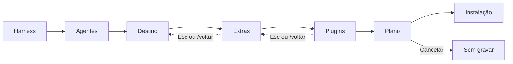

<p align="center">
  
</p>

<h1 align="center">Kit de Desenvolvimento GEX</h1>
<p align="center">Claude Code e Codex preparados para o trabalho GEX, do primeiro comando à revisão do PR.</p>

<p align="center">
  
  
  
  
  
  
  
</p>

<p align="center">
  <a href="#-instalação-em-1-minuto">Instalar</a> · <a href="#-primeiro-uso">Primeiro uso</a> · <a href="#-receitas-por-tarefa">Receitas</a> · <a href="#-solução-de-problemas">Ajuda</a> · <a href="#-referência">Referência</a> · <a href="CHANGELOG.md">Changelog</a>
</p>

**O que muda no seu ambiente?** O Core grava instruções globais para Claude Code/Codex e sete skills `gex-*` no HOME. Você escolhe se adiciona sete especializações, 18 skills Matt Pocock, hooks de agente e git hooks por repositório. O chat segue um roteiro local, sem chamar um modelo de IA.

> [!NOTE]
> O Core não modifica MCPs nem arquivos de projeto. Git hooks exigem seleção do repositório. Antes de gravar, o kit mostra arquivos, versões, conflitos e diff; `--yes` dispensa a pergunta, não a prévia. Há histórico das cinco gravações mais recentes, com prévia e confirmação no `rollback`.

## 🚀 Instalação em 1 minuto

> [!IMPORTANT]
> A [release é privada](https://github.com/Gex-Development/gex-dev-kit/releases/tag/v0.3.0). Você precisa do **GitHub CLI (`gh`) instalado**, executar `gh auth login` e ter acesso à organização **Gex-Development**. O instalador é lido do próprio repositório autenticado; confira o comando antes de executá-lo.

| Sistema | Instalar `gh` antes do kit |
|---|---|
| macOS | `brew install gh` |
| Linux | [Instruções oficiais para apt/dnf e outras distribuições](https://github.com/cli/cli/blob/trunk/docs/install_linux.md) |
| Windows | `winget install --id GitHub.cli` no PowerShell; reabra o terminal |

Depois, em qualquer sistema, entre na sua conta: `gh auth login`. Escolha o seu sistema:

<details open>
<summary><strong>macOS e Linux</strong> · Apple Silicon, Intel, arm64, amd64 (WSL conta como Linux)</summary>

```bash
gh api -H "Accept: application/vnd.github.raw" \
  repos/Gex-Development/gex-dev-kit/contents/scripts/install.sh | bash
```

- Identifica o sistema e a arquitetura (inclusive shell sob Rosetta no Mac) e baixa **só** o binário certo e o `SHA256SUMS`.
- Confere o SHA-256 **antes** de instalar; se não bater, nada é instalado.
- Instala como `gex-dev-kit` em `~/.local/bin`, de forma atômica, sem `sudo` e sem editar seus arquivos de shell.
- Se `~/.local/bin` não estiver no seu PATH, mostra a linha pronta para copiar; depois abra um terminal novo.
- Para atualizar, rode o mesmo comando de novo. O binário Linux é estático.

</details>

<details>
<summary><strong>Windows</strong> · ARM64 ou AMD64, no Windows Terminal com PowerShell 5.1 ou 7</summary>

```powershell
[Console]::OutputEncoding = [Text.Encoding]::UTF8
& ([scriptblock]::Create((gh api -H "Accept: application/vnd.github.raw" `
    repos/Gex-Development/gex-dev-kit/contents/scripts/install.ps1 | Out-String)))
```

- A primeira linha só garante os acentos corretos na saída do instalador.
- Identifica a arquitetura (inclusive PowerShell de 32 bits), baixa **só** o `.exe` certo e o `SHA256SUMS` e confere o SHA-256 antes de instalar.
- Instala `gex-dev-kit.exe` em `%LOCALAPPDATA%\Programs\gex-dev-kit` e acrescenta a pasta ao PATH do **usuário** (não da máquina) e da sessão atual. `-NoPath` não mexe no PATH.
- Se o SmartScreen ou o antivírus perguntarem, confira a origem e o checksum antes de autorizar.
- Para atualizar, rode o mesmo comando de novo (feche o `gex-dev-kit` antes).

</details>

Confirme em qualquer sistema com `gex-dev-kit --version`.

> [!TIP]
> Para fixar a versão ou a pasta de instalação, troque o `| bash` do final por `| bash -s -- --version v0.3.0 --dir "$HOME/bin"`. No Windows, acrescente `-Version v0.3.0 -InstallDir "$HOME\bin" -NoPath` depois do último parêntese.

<details>
<summary><strong>Desinstalar</strong></summary>

1. **Opcional, antes de apagar o executável:** desfaça o que o kit gravou no HOME com `gex-dev-kit rollback` (ou `gex-dev-kit rollback --home CAMINHO_ABSOLUTO`, se instalou o Core em outro HOME). Cada chamada desfaz **uma** gravação e mostra a prévia; repita conforme o histórico disponível. Hooks Git de um repositório se desfazem com `gex-dev-kit rollback --repo CAMINHO_ABSOLUTO`.
2. **Apague o executável:** `~/.local/bin/gex-dev-kit` (macOS/Linux) ou `%LOCALAPPDATA%\Programs\gex-dev-kit` (Windows, e tire a pasta do PATH do usuário se não for mais usá-la).
3. **Cópia usada pelos hooks:** o kit pode manter outra cópia em `~/.local/share/gex-dev-kit/bin/gex-dev-kit` (Windows: `gex-dev-kit.exe` nesse diretório). **Não a apague enquanto houver hooks ativos.** O `rollback` de cada gravação restaura ou remove essa cópia quando ela participou da gravação; confira a prévia.
4. **O rollback não desinstala** plugins nem a primeira instalação dos agentes: remova plugins pelo próprio Claude Code ou Codex.

</details>

<details>
<summary><strong>Instalação manual · ativos, checksum e nome curto</strong></summary>

| Sistema | Arquitetura | Ativo da v0.3.0 |
|---|---|---|
| macOS | Apple Silicon (arm64) | `gex-dev-kit_v0.3.0_darwin_arm64` |
| macOS | Intel (amd64) | `gex-dev-kit_v0.3.0_darwin_amd64` |
| Linux / WSL | arm64 | `gex-dev-kit_v0.3.0_linux_arm64` |
| Linux / WSL | amd64 | `gex-dev-kit_v0.3.0_linux_amd64` |
| Windows | ARM64 | `gex-dev-kit_v0.3.0_windows_arm64.exe` |
| Windows | AMD64 | `gex-dev-kit_v0.3.0_windows_amd64.exe` |

Baixe **somente** o ativo do seu sistema e `SHA256SUMS`, nunca precisa baixar as seis plataformas. Exemplo para Linux amd64 (troque o nome exato da tabela):

```bash
gh release download v0.3.0 --repo Gex-Development/gex-dev-kit --pattern 'gex-dev-kit_v0.3.0_linux_amd64' --pattern SHA256SUMS
sha256sum -c --ignore-missing SHA256SUMS
chmod +x gex-dev-kit_v0.3.0_linux_amd64
mkdir -p "$HOME/.local/bin"
mv gex-dev-kit_v0.3.0_linux_amd64 "$HOME/.local/bin/gex-dev-kit"
```

`--ignore-missing` evita erro para os outros cinco arquivos ausentes; **confirme que a saída menciona seu ativo: OK**. No macOS, troque o nome do ativo no download e confira somente sua linha (exemplo Apple Silicon):

```bash
grep '  gex-dev-kit_v0.3.0_darwin_arm64$' SHA256SUMS | shasum -a 256 -c -
chmod +x gex-dev-kit_v0.3.0_darwin_arm64
mkdir -p "$HOME/.local/bin"
mv gex-dev-kit_v0.3.0_darwin_arm64 "$HOME/.local/bin/gex-dev-kit"
```

No PowerShell, baixe o ativo Windows da tabela e `SHA256SUMS` com `gh release download v0.3.0 --repo Gex-Development/gex-dev-kit --pattern 'gex-dev-kit_v0.3.0_windows_amd64.exe' --pattern SHA256SUMS`; compare `Get-FileHash .\gex-dev-kit_v0.3.0_windows_amd64.exe -Algorithm SHA256` com a linha **desse arquivo** em `SHA256SUMS`. Só depois renomeie para `gex-dev-kit.exe` na pasta de instalação. Os avisos de dependências estão em `THIRD_PARTY_LICENSES.txt` da release.

</details>

> [!WARNING]
> Linux e Windows foram compilados e verificados com `go vet`, **não exercitados em execução** nesta release; testes rodaram em macOS.

## 🧭 Primeiro uso

**1. Abra o chat:** rode `gex-dev-kit` em um terminal interativo, pressione `Enter` ou clique nas boas-vindas e digite `/setup`.

**2. Escolha e revise:** selecione Claude Code/Codex, destino e Extras; no plano confira comandos, conflitos e diff. **Agora não** evita atualizar os executáveis dos agentes.



**3. Confirme:** escolha **Sim, aplicar**. A entrada fica travada enquanto o assistente escreve ou executa uma ferramenta. Depois, `gex-dev-kit doctor` confere o resultado.

<details>
<summary><strong>Como é a conversa? Trecho real da v0.3.0</strong></summary>

Sessão em terminal com HOME descartável e Core não instalado; resultado dos agentes depende do PATH:

```text
◆ Olá! Eu sou o assistente do Kit GEX. Vou configurar seu ambiente de desenvolvimento com você.

╭─ ✓ Verificar ambiente ~ ─────────────────────────────────────────────────────────────────────────╮
│ ✓ HOME         ~                                                                                 │
│ ! Claude Code  bloqueado · múltiplos executáveis no PATH; resolver colisão antes da instalação   │
│ ! Codex        bloqueado · múltiplos executáveis no PATH; resolver colisão antes da instalação   │
│ i Core         0/7 skills · não instalado                                                        │
╰───────────────────────────────────────────────────────────────────────────────────────────── 4s ─╯

◆ Ainda não há Core instalado neste HOME.

◆ Digite / para ver o que posso fazer. Para configurar o ambiente, use /setup.
```

Sem capturas antigas: elas mostram a interface anterior. A barra do chat mostra harness detectado, projeto e branch Git (contagens `*N` modificados e `?N` não rastreados); o HOME de instalação aparece quando difere do HOME real. A borda do prompt indica `Core N/7` ou `Etapa N/7`. `GEX_NO_POWERLINE=1` troca separadores por `›`; modo Plain usa ASCII. Com animação, texto chega por palavras (~55 caracteres/s, pausas e teto aproximado de 9 s para textos longos); há intervalos entre mensagens e cartões de ferramenta mostram fases, resultado e duração. `Enter` ou espaço pula a animação; `--no-anim` exibe tudo imediatamente.

</details>

## 🛠️ Receitas por tarefa

| Quero… | Faça |
|---|---|
| Instalar o executável do kit | Use o comando do seu SO em [Instalação](#-instalação-em-1-minuto) |
| Verificar o ambiente | `gex-dev-kit doctor` |
| Desfazer a última instalação do Core | `gex-dev-kit rollback` |
| Instalar uma skill opcional, além do Core | `gex-dev-kit install --skill tdd` |
| Listar skills, hooks e plugins | `gex-dev-kit skills`, `gex-dev-kit hooks`, `gex-dev-kit addons` |
| Configurar git hooks de um repositório | `gex-dev-kit githooks --repo "$(pwd)"` (a partir do repositório) |
| Atualizar o executável | Repetir o comando do seu SO em [Instalação](#-instalação-em-1-minuto); `gex-dev-kit install` atualiza o Core separadamente |
| Usar em automação/CI | `gex-dev-kit install --skip-agent-update --yes --ui=cli` para gravar; `gex-dev-kit doctor --json` para ler estado (`--json` não se aplica a `install`) |
| Testar sem tocar no HOME real | `PILOT_HOME="$(mktemp -d)"; gex-dev-kit install --home "$PILOT_HOME" --skip-agent-update --yes; gex-dev-kit doctor --home "$PILOT_HOME"; gex-dev-kit rollback --home "$PILOT_HOME" --yes` |

> [!TIP]
> `--yes` confirma **depois** de mostrar a prévia. Use HOME descartável e `--skip-agent-update` ao experimentar, para não atualizar agentes nem tocar em arquivos do seu HOME.

## 🩺 Solução de problemas

| Sintoma | Causa | Correção |
|---|---|---|
| `gh: command not found` | GitHub CLI ausente | Instale `gh` conforme a tabela por SO acima; depois `gh auth login` |
| Falha em `gh auth` | Sessão não autenticada | Execute `gh auth login` e tente novamente |
| `release not found` ou acesso negado | Sem acesso à release privada/organização | Confirme a conta autenticada em `gh auth status` e peça acesso à organização Gex-Development |
| `gex-dev-kit: command not found` | Pasta de instalação fora do PATH ou sessão antiga | Execute a linha indicada pelo instalador; exemplos abaixo. Abra outro terminal após editar o perfil |
| Quadrados nos separadores da barra | Fonte sem glifos Powerline | Use uma Nerd Font no terminal ou `GEX_NO_POWERLINE=1 gex-dev-kit` (PowerShell: `$env:GEX_NO_POWERLINE='1'; gex-dev-kit`) |
| TUI sem cor ou animação | `NO_COLOR` desliga cores; `CI` força modo CLI automático e desliga animação; `TERM=dumb` força texto e desliga cor/animação | Remova essas variáveis para testar a TUI; `ACCESSIBLE=1` também seleciona menu texto no modo automático; `GEX_NO_ANIM=1` ou `--no-anim` desliga animação |
| `--ui=tui` sem terminal | Entrada e saída precisam de TTY; `TERM=dumb` também impede TUI | Execute em terminal interativo, sem `TERM=dumb`, ou use `--ui=cli` (erro de uso: código 2) |
| Aviso do Gatekeeper/SmartScreen | Restrição de execução do sistema | Confira a origem autenticada e o SHA-256 antes de permitir a execução; não desative a proteção global |
| `doctor`: agente “bloqueado · múltiplos executáveis no PATH” | PATH ambíguo impede escolher binário gerenciado | Identifique as cópias no PATH, resolva a colisão e rode `gex-dev-kit doctor` novamente; o Core continua disponível |

**PATH no Unix** (se instalou no diretório padrão):

| Shell | Linha para acrescentar ao perfil |
|---|---|
| zsh | `echo 'export PATH="$HOME/.local/bin:$PATH"' >> ~/.zshrc` |
| bash no macOS | `echo 'export PATH="$HOME/.local/bin:$PATH"' >> ~/.bash_profile` |
| bash no Linux | `echo 'export PATH="$HOME/.local/bin:$PATH"' >> ~/.bashrc` |
| fish | `fish_add_path ~/.local/bin` |

No PowerShell, o instalador atualiza PATH do usuário e da sessão atual por padrão; com `-NoPath`, rode `$env:PATH += ";$env:LOCALAPPDATA\Programs\gex-dev-kit"` na sessão ou adicione a pasta manualmente às variáveis de ambiente do usuário.

## 📖 Referência

<details>
<summary><strong>Comandos e atalhos do chat</strong></summary>

Digite `/` para abrir a paleta (`↑`/`↓` escolhem, `Tab` completa). Também aceita buscas como “instalar”, “skill”, “verificar”, “desfazer”, “agente”, “git hook” e “addon”.

| Comando | Ação |
|---|---|
| `/setup` | Configurar ou atualizar o kit |
| `/catalogo` | Explorar skills e hooks com “O que faz”, “Quando usar” e “Analogia” |
| `/doctor` | Verificar a integridade |
| `/rollback` | Desfazer a última instalação |
| `/agentes` | Restaurar versões anteriores dos agentes |
| `/githooks` | Configurar git hooks |
| `/addons` | Ver e instalar plugins após revisão e confirmação |
| `/menu` | Mostrar as opções como lista |
| `/voltar` | Voltar uma etapa |
| `/ajuda` | Listar comandos e atalhos |
| `/limpar` | Limpar a conversa atual |
| `/sair` | Encerrar |

**Atalhos:** espaço ou `1`–`9` marca itens, `Enter` confirma (ou escolhe o item sob o cursor quando obrigatório). Clique em **Confirmar (N)** ou **Pular (nenhuma marcada)** para avançar; Extras vazios não instalam opcionais. `Esc` limpa a entrada ou volta; `/voltar` volta etapa. `←`/`→`, `PageUp`/`PageDown` ou clique nas setas trocam a página de escolhas longas (`‹ página i/n ›`); marcações persistem, números valem na página atual. Com texto digitado, setas movem o cursor. Sem escolha paginada, roda e `PageUp`/`PageDown` rolam a conversa. Paleta e navegador de pastas mostram `… mais N`: digite para filtrar. `Tab` completa caminhos, `Enter` abre pasta destacada e é possível colar pelo terminal. `Ctrl+O` ou clique no título expande um cartão; `Ctrl+C` sai. O catálogo separa Core, Engenharia, Produtividade, Especializações e Referências.

</details>

<details>
<summary><strong>CLI, modos e opções</strong></summary>

```sh
gex-dev-kit skills
gex-dev-kit install --skill tdd --hook gex-conventional-commits
gex-dev-kit doctor
gex-dev-kit rollback
```

| Comando | Para que serve |
|---|---|
| `install` | Mostra prévia, pede confirmação e grava Core e escolhas |
| `doctor` | Confere HOME (`--home`) ou git hooks de repositório (`--repo`) |
| `rollback` | Desfaz última gravação do HOME ou repositório, com prévia |
| `rollback-agents` | Restaura versão anterior de Claude Code/Codex, com confirmação |
| `skills` | Lista Core, opcionais e referências |
| `hooks` | Lista hooks de agente, git hooks e referências |
| `addons [NOME]` | Lista plugins ou mostra comando oficial; **não instala** |
| `githooks --repo CAMINHO` | Prévia dos git hooks; grava com confirmação |
| `ds` | Vitrine do Design System (`--ui=cli` mostra em texto) |
| `version` | Mostra versão |
| `help [COMANDO]` | Ajuda geral ou por comando |

| Situação | Interface |
|---|---|
| Terminal interativo, sem opção extra | Chat (TUI) |
| `--yes`, `--quiet`, `--json` ou `--ui=cli` | CLI |
| `--ui=tui` sem terminal interativo | Erro de uso (código 2) |
| `ACCESSIBLE=1` ou `TERM=dumb` | Menu e confirmação em texto |
| `NO_COLOR=1` em terminal interativo | Chat sem cores |

Opções globais: `--ui=auto|tui|cli`, `--no-anim`, `--quiet`, `--json` (em `skills`, `hooks`, `addons`, `doctor`), `-h`/`--help` e `-v`/`--version`. `--home` (em `install`, `doctor`, `rollback`, `rollback-agents`, `githooks`) e `--repo` aceitam apenas caminho absoluto. `--skill` e `--hook` podem ser repetidos. Sem Extras, `install` grava o Core e tenta atualizar os agentes elegíveis; `--skip-agent-update` evita rede e mudanças nos binários dos agentes. `--yes` confirma após a prévia. `--json` imprime apenas JSON no stdout; `skills --json` usa `gex-dev-kit.skills/v1`, introduzido na v0.3.0, sem `credentials` nas especializações (skills de API de gateway não fazem parte do catálogo; o kit não pede nem grava essas chaves).

</details>

<details>
<summary><strong>Códigos de saída</strong></summary>

| Saída | Significado |
|---|---|
| `0` | Concluído sem falha |
| `1` | Falha de execução ou verificação, por exemplo arquivo alterado no `doctor` |
| `2` | Uso inválido: comando/flag desconhecido, valor ausente, caminho relativo, skill/hook desconhecido, `--repo` sem Git ou `--run`/`--pre-commit-run` sem hook correspondente |
| `129` | SIGHUP (terminal fechado) |
| `130` | Ctrl+C (SIGINT) |
| `143` | SIGTERM |

Durante gravação, um sinal aguarda a gravação em curso terminar antes de encerrar. Agente externo não gerenciado gera aviso no `doctor`, sem alterar seu código de saída.

</details>

### O que o kit instala

**Core:** instruções em `~/.claude/CLAUDE.md` e `~/.codex/AGENTS.md`; sete skills em `~/.claude/skills/` e `~/.agents/skills/`:

`gex-abrir-issue`, `gex-auto-revisao`, `gex-fluxo-desenvolvimento`, `gex-preparar-pr`, `gex-regras-de-negocio`, `gex-revisar-pr`, `gex-verificar-mudanca`.

<details>
<summary><strong>Catálogo opcional: especializações, Matt e hooks</strong></summary>

**Especializações opcionais (7):**

| Grupo | Skills |
|---|---|
| Dados e Plataforma | `gex-local-spark-tests`, `gex-canonical-prod-readiness`, `gex-hub-gold-refresh-prod`, `gex-gateway-audit`, `gex-pr-review` |
| Produto e Interface | `gex-design-system`, `gex-hub-design-system` |

Algumas exigem credenciais/permissões externas e autorização própria para agir em produção; copiar a skill não executa essas ações. `gex-pr-review` requer `gex-local-spark-tests`.

**Matt Pocock (18, opcionais):** cópias offline do [commit `5beb35b0`](https://github.com/mattpocock/skills/tree/5beb35b040e3de97e54fa9e386d7e42d15c295c2), sob [MIT da fonte](https://github.com/mattpocock/skills/blob/5beb35b040e3de97e54fa9e386d7e42d15c295c2/LICENSE): `code-review`, `codebase-design`, `diagnosing-bugs`, `domain-modeling`, `grill-me`, `grill-with-docs`, `grilling`, `handoff`, `improve-codebase-architecture`, `pr`, `prototype`, `research`, `retro`, `tdd`, `teach`, `to-questionnaire`, `wait-what`, `writing-for-agents`. Instalá-las apenas copia arquivos; usar skills que criam issues, labels, branches ou modificam projetos exige autorização separada. Outras 11 (`setup-matt-pocock-skills`, `implement-spec`, `ask-matt` etc.) são **somente referências**, não instaláveis.

**Hooks de agente (4, por escolha):** `gex-conventional-commits` (bloqueia mensagem literal fora do padrão), `gex-sensitive-action-warning` (pede confirmação de ação sensível), `gex-pre-pr` (confirma PR), `gex-session-start` (contexto ao iniciar, opt-in). Os hooks de política só agem com remote de `Gex-Development`, `Gex-Integrations`, `gex-data-architecture-org`, `gex-data-architecture` (sem distinguir maiúsculas) ou `git config gex.policy true`; `false` desliga. Organizações extras entram no arquivo `orgs` da configuração do usuário; `doctor` mostra a lista efetiva. No Codex, os dois hooks que pediriam confirmação não são suportados; aprove hooks instalados em `/hooks`. Em `claude -p`, perguntas de `gex-sensitive-action-warning` e `gex-pre-pr` viram negação: não instale esses hooks em máquinas de automação. Há ainda **25 referências** de hooks de terceiros, não instaladas.

**Git hooks (3, por repositório):** `gex-commit-msg` valida Conventional Commits, `gex-pre-commit` procura possíveis credenciais no diff e roda comandos rápidos documentados pelo projeto, `gex-pre-push` roda comandos documentados passados com `--run`. O hook de agente `gex-conventional-commits` não substitui validação por Git nem proteção remota. Configurações existentes são preservadas; merge de hooks é aditivo e reinstalação atualiza o executável dos hooks.

</details>

### Plugins opcionais

Só a etapa **Plugins** de `/setup` ou `/addons` no chat instala plugins. Escolha Claude Code e/ou Codex, confira comandos e conflitos com o Core e confirme. A CLI `addons` apenas consulta o catálogo; a CLI `install` não instala plugins.

| Plugin | Para quê | Instalação pelo chat | Passo manual |
|---|---|---|---|
| `caveman` | Respostas curtas | Claude Code por tag `v4.0.1`; Codex via `npx` por commit | Aprovar hook no Codex em `/hooks` |
| `ponytail` | Menor mudança completa | Claude Code por tag `v5.3.2`; Codex por commit | Aprovar hooks no Codex em `/hooks` |
| `superpowers` | Brainstorming, TDD, planos e revisão | Claude Code via marketplace oficial | No Codex, `/plugins` → superpowers → Install Plugin |
| `spec-kit` | Fluxo de especificação | `uv tool install` por commit verificado | `specify init . --integration claude` ou `codex` em cada projeto |

> [!WARNING]
> Plugins são **código de terceiros** executado com seus privilégios. Os comandos são executados sem shell, em grupo de processos próprio, com HOME escolhido, ambiente reduzido e timeout de cinco minutos por passo. Revise fonte, licença e comandos antes de confirmar. **Rollback não desfaz plugins**: remova-os no próprio Claude Code/Codex.

As tags de `caveman` e `ponytail` no Claude Code **não são** os commits conferidos do catálogo; o marketplace não aceita commit como referência. O pin de `superpowers` depende do marketplace oficial e pode mudar. `spec-kit` requer Python 3.11+ e `uv`. Instaladores ausentes viram instrução manual. Um plugin pode alterar `settings.json`/`hooks.json` após o Core, causando conflito no `rollback` ou aviso no `doctor`. O kit reduz as variáveis passadas (tokens como `GH_TOKEN`/`NPM_TOKEN` não chegam ao instalador), mas a filtragem da saída não cobre todos os formatos de segredo/caracteres de controle. Veja a [análise completa de segurança e fixação nas notas v0.3.0](docs/release-notes/v0.3.0.md).

### Agentes e git hooks por projeto

Versões fixadas nesta release: **Claude Code 2.1.306** e **Codex 0.163.0**. O kit só instala/atualiza executáveis standalone que gerencia, no perfil do usuário, por instaladores oficiais e versão exata. Brew, npm, winget, apt, dnf, binários não gerenciados, PATH ambíguo e atualização nativa fora do pin bloqueiam essa operação: o Core ainda pode ser instalado, mas o comando retorna erro e não afirma atualização. `rollback-agents` só reverte upgrade gerenciado com versão anterior registrada; a primeira instalação não é desinstalada automaticamente. Login e modelo não são alterados.

`gex-dev-kit githooks --repo CAMINHO_ABSOLUTO` mostra prévia e grava somente após confirmação; `gex-dev-kit rollback --repo CAMINHO_ABSOLUTO` desfaz a gravação. Use `--hook gex-pre-commit --pre-commit-run "go vet ./..."` ou `--hook gex-pre-push --run "go test ./..."` apenas quando esses comandos estiverem documentados no projeto.

### Desenvolvimento

```sh
go test ./...
go vet ./...
go build -o /tmp/gex-dev-kit-piloto ./cmd/gex-dev-kit
./scripts/smoke.sh /tmp/gex-dev-kit-piloto
```

- `scripts/check.sh`: formato, comentários, vet, testes, build e smoke local.
- `scripts/smoke.sh CAMINHO_DO_BINARIO`: instalação, doctor, hook e rollback em HOME descartável.
- `scripts/demo.sh`: compila e abre a TUI em HOME descartável.
- `scripts/release.sh vX.Y.Z`: compila seis alvos (máximo 16 MiB cada), gera `dist/SHA256SUMS` e avisos das dependências; exige `docs/release-notes/vX.Y.Z.md`. Não publica sem `--publish` e confirmação explícita.

| Pasta | Responsabilidade |
|---|---|
| `cmd/gex-dev-kit` | Entrada da CLI, comandos, sinais e JSON |
| `internal/app` | Casos de uso compartilhados por CLI e TUI |
| `internal/catalog` | Catálogo Core, opcionais, plugins e hooks |
| `internal/kit` | Gravação segura e histórico no HOME |
| `internal/agents` | Controle dos binários dos agentes |
| `internal/hooks` | Hooks de agente |
| `internal/githooks` | Git hooks por projeto |
| `internal/ui` | Tema, componentes e chat; `ds` separado |

Commits seguem Conventional Commits. Não há CI remoto nesta fase. Consulte [CHANGELOG](CHANGELOG.md), [notas da v0.3.0](docs/release-notes/v0.3.0.md), [decisões (ADR)](docs/ADR.md), [arquitetura](docs/ARCHITECTURE.md), [contexto](docs/CONTEXT.md) e [auditoria de UX](docs/AUDITORIA-UX.md) para histórico e detalhes.

Fontes de compatibilidade: [hooks Claude Code](https://code.claude.com/docs/en/hooks), [hooks Codex](https://developers.openai.com/codex/hooks), [instalação Claude Code](https://code.claude.com/docs/en/setup), [instalação Codex](https://developers.openai.com/codex/cli).
