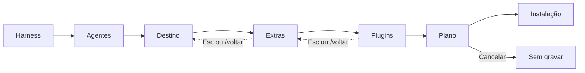

<p align="center">
  
</p>

<h1 align="center">Kit de Desenvolvimento GEX</h1>
<p align="center">Prepare Claude Code e Codex para trabalhar na GEX, do primeiro comando à revisão do PR.</p>

<div align="center">

![macOS arm64 e amd64][badge-macos] ![Linux arm64 e amd64][badge-linux] ![Windows arm64 e amd64][badge-windows]

![Versão v0.3.4][badge-version] ![Go 1.25.8][badge-go] ![Interface TUI e CLI][badge-interface] ![Agente Claude Code][badge-claude] ![Agente Codex][badge-codex] ![Conventional Commits][badge-commits] ![GitHub CLI necessário][badge-gh]

</div>

<p align="center">
  <a href="#instalação-em-1-minuto">Instalar</a> · <a href="#primeiro-uso">Primeiro uso</a> · <a href="#receitas-por-tarefa">Receitas</a> · <a href="#solução-de-problemas">Ajuda</a> · <a href="#referência">Referência</a> · <a href="CHANGELOG.md">Changelog</a>
</p>

## Visão geral

*Entenda o alcance do kit antes de instalar.*

- **O que é:** CLI e chat local que configuram Claude Code e Codex sem chamar um modelo de IA.
- **Para quem:** pessoas que criam, revisam e entregam projetos da GEX.
- **O que muda no computador:** o Core grava instruções globais e sete skills `gex-*` no HOME. Você decide se adiciona sete especializações, 18 skills Matt Pocock, hooks e git hooks por repositório.

> [!NOTE]
> O Core não altera MCPs nem arquivos de projeto. Git hooks exigem seleção do repositório. Antes de gravar, o kit mostra arquivos, versões, conflitos e diff. `--yes` dispensa a pergunta, mas não a prévia. O histórico guarda as cinco gravações mais recentes; `rollback` mostra prévia e pede confirmação.

<details>
<summary>Glossário · termos usados neste guia</summary>

- **Core:** instruções globais e sete skills GEX instaladas por padrão.
- **Harness:** Claude Code ou Codex, o ambiente que usa as instruções e skills.
- **HOME:** pasta pessoal onde o kit grava configuração e histórico; `--home` permite escolher outra pasta.
- **Extras:** skills e hooks opcionais escolhidos durante o setup.
- **Plugins e MCPs:** ferramentas de terceiros instaladas pelo chat após confirmação; MCPs são servidores de ferramentas registrados nos clientes, não no Core.
- **Prévia:** lista de mudanças e diff mostrados antes de gravar ou desfazer.
- **Rollback:** desfaz uma gravação registrada; não desinstala plugins, MCPs nem a primeira instalação dos agentes.
- **Hook (agente):** ação acionada pelo Claude Code ou Codex em eventos do agente.
- **Git hook:** ação executada pelo Git em eventos de um repositório.

</details>

## Instalação em 1 minuto

*Instale o GitHub CLI, autentique-se e escolha o comando do seu sistema.*

> [!IMPORTANT]
> A [última release é privada](https://github.com/Gex-Development/gex-dev-kit/releases/latest). Instale **GitHub CLI (`gh`)**, rode `gh auth login` e confirme seu acesso à **Gex-Development**. O instalador vem do repositório autenticado: revise o comando antes de executá-lo.

| Sistema | Instale `gh` |
|---|---|
| macOS | `brew install gh` |
| Linux | [Instruções oficiais para apt, dnf e outras distribuições](https://github.com/cli/cli/blob/trunk/docs/install_linux.md) |
| Windows | `winget install --id GitHub.cli` no PowerShell; reabra o terminal |

Depois, rode `gh auth login` em qualquer sistema.

### macOS ![macOS arm64 e amd64][badge-macos]

```bash
gh api -H "Accept: application/vnd.github.raw" \
  repos/Gex-Development/gex-dev-kit/contents/scripts/install.sh | bash
```

- Detecta Apple Silicon ou Intel, mesmo sob Rosetta. Baixa apenas o binário adequado e `SHA256SUMS`.
- Confere SHA-256 antes de instalar; não instala se a conferência falhar.
- Instala atomicamente em `~/.local/bin`, sem `sudo` nem edição do perfil do shell.
- Se faltar PATH, mostra a linha para copiar. Abra outro terminal. Para atualizar, repita o comando.

### Linux / WSL ![Linux arm64 e amd64][badge-linux]

```bash
gh api -H "Accept: application/vnd.github.raw" \
  repos/Gex-Development/gex-dev-kit/contents/scripts/install.sh | bash
```

- Detecta arm64 ou amd64. Baixa apenas o binário estático adequado e `SHA256SUMS`.
- Confere SHA-256 antes de instalar; não instala se a conferência falhar.
- Instala atomicamente em `~/.local/bin`, sem `sudo` nem edição do perfil do shell.
- Se faltar PATH, mostra a linha para copiar. Abra outro terminal. Para atualizar, repita o comando.

### Windows ![Windows ARM64 e AMD64][badge-windows]

*Use Windows Terminal com PowerShell 5.1 ou 7.*

```powershell
[Console]::OutputEncoding = [Text.Encoding]::UTF8
& ([scriptblock]::Create((gh api -H "Accept: application/vnd.github.raw" `
    repos/Gex-Development/gex-dev-kit/contents/scripts/install.ps1 | Out-String)))
```

- A primeira linha preserva acentos. O script detecta ARM64 ou AMD64, mesmo em PowerShell de 32 bits.
- Baixa apenas o `.exe` adequado e `SHA256SUMS`. Confere SHA-256 antes de instalar.
- Instala em `%LOCALAPPDATA%\Programs\gex-dev-kit`. Atualiza PATH do usuário e da sessão; `-NoPath` não altera PATH.
- Confira origem e checksum antes de autorizar SmartScreen ou antivírus. Para atualizar, feche o kit e repita o comando.

Confirme com `gex-dev-kit --version` em qualquer sistema.

> [!TIP]
> Para escolher versão e pasta, substitua `| bash` por `| bash -s -- --version vX.Y.Z --dir "$HOME/bin"` (troque `vX.Y.Z` pela versão que quer). No Windows, acrescente `-Version vX.Y.Z -InstallDir "$HOME\bin" -NoPath` após o último parêntese.

<details>
<summary>Desinstalar · desfazer gravações, remover executável e conferir hooks</summary>

1. Opcional: rode `gex-dev-kit rollback` antes de remover o executável. Para outro HOME, use `gex-dev-kit rollback --home CAMINHO_ABSOLUTO`. Cada chamada mostra a prévia e desfaz uma gravação; repita enquanto houver histórico. Para git hooks, use `gex-dev-kit rollback --repo CAMINHO_ABSOLUTO`.
2. Remova `~/.local/bin/gex-dev-kit` no macOS/Linux ou `%LOCALAPPDATA%\Programs\gex-dev-kit` no Windows. No Windows, retire a pasta do PATH do usuário se não for mais usá-la.
3. O kit pode manter uma cópia em `~/.local/share/gex-dev-kit/bin/gex-dev-kit`, ou `gex-dev-kit.exe` nessa pasta no Windows. **Não remova essa cópia enquanto houver hooks ativos.** O rollback restaura ou remove a cópia quando ela fez parte da gravação; confira a prévia.
4. **Rollback não desinstala plugins, MCPs nem a primeira instalação dos agentes.** Remova plugins pelo Claude Code ou Codex. Os comandos de remoção dos MCPs estão em **Referência**, no bloco **Plugins e MCPs opcionais**.

</details>

<details>
<summary>Instalação manual · ativos da release, checksum e nome curto</summary>

| Sistema | Arquitetura | Ativo `gex-dev-kit_<versão>_<sistema>_<arquitetura>` |
|---|---|---|
| macOS | Apple Silicon (arm64) | `gex-dev-kit_<versão>_darwin_arm64` |
| macOS | Intel (amd64) | `gex-dev-kit_<versão>_darwin_amd64` |
| Linux / WSL | arm64 | `gex-dev-kit_<versão>_linux_arm64` |
| Linux / WSL | amd64 | `gex-dev-kit_<versão>_linux_amd64` |
| Windows | ARM64 | `gex-dev-kit_<versão>_windows_arm64.exe` |
| Windows | AMD64 | `gex-dev-kit_<versão>_windows_amd64.exe` |

Baixe somente o ativo escolhido e `SHA256SUMS`; não precisa baixar os seis binários. Exemplo para Linux amd64:

```bash
gh release download --repo Gex-Development/gex-dev-kit --pattern '*_linux_amd64' --pattern SHA256SUMS
grep '  gex-dev-kit_.*_linux_amd64$' SHA256SUMS | shasum -a 256 -c -
chmod +x gex-dev-kit_*_linux_amd64
mkdir -p "$HOME/.local/bin"
mv gex-dev-kit_*_linux_amd64 "$HOME/.local/bin/gex-dev-kit"
```

O `gh release download` sem tag baixa a última release. Os padrões `*` pressupõem uma pasta sem outros downloads do kit. Em Linux com `sha256sum`, você pode trocar `shasum -a 256 -c -` por `sha256sum -c -`. **Confira se a saída menciona seu ativo: OK.** No macOS, baixe o ativo correspondente. Exemplo Apple Silicon:

```bash
gh release download --repo Gex-Development/gex-dev-kit --pattern '*_darwin_arm64' --pattern SHA256SUMS
grep '  gex-dev-kit_.*_darwin_arm64$' SHA256SUMS | shasum -a 256 -c -
chmod +x gex-dev-kit_*_darwin_arm64
mkdir -p "$HOME/.local/bin"
mv gex-dev-kit_*_darwin_arm64 "$HOME/.local/bin/gex-dev-kit"
```

No PowerShell, baixe o ativo Windows e `SHA256SUMS` em uma pasta sem outros downloads do kit:

```powershell
gh release download --repo Gex-Development/gex-dev-kit --pattern '*_windows_amd64.exe' --pattern SHA256SUMS
Get-FileHash .\gex-dev-kit_*_windows_amd64.exe -Algorithm SHA256
```

Compare o hash com a linha **desse arquivo** em `SHA256SUMS`. Só depois renomeie para `gex-dev-kit.exe` na pasta de instalação. Consulte `THIRD_PARTY_LICENSES.txt` da release para avisos das dependências.

</details>

> [!WARNING]
> Nesta release, apenas macOS foi exercitado em execução. Linux e Windows compilam e passam em `go vet`; o `install.ps1` não foi executado.

## Primeiro uso

*Abra o chat, escolha as opções e revise o plano antes de gravar.*

1. **Abra:** execute `gex-dev-kit` num terminal interativo. Pressione `Enter` ou clique nas boas-vindas; digite `/setup`.
2. **Escolha:** selecione Claude Code/Codex, destino e Extras. Confira comandos, conflitos e diff. **Agora não** evita atualizar os executáveis dos agentes.
3. **Confirme:** escolha **Sim, aplicar**. A entrada trava enquanto o assistente escreve ou executa uma ferramenta. Depois, rode `gex-dev-kit doctor`.



<details>
<summary>Conversa real da v0.3.0 · exemplo e comportamento do chat</summary>

Sessão com HOME descartável e Core ausente. O resultado dos agentes depende do PATH:

```text
◆ Olá! Eu sou o assistente do Kit GEX. Vou configurar seu ambiente de desenvolvimento com você.

╭─ ✓ Verificar ambiente ~ ─────────────────────────────────────────────────────────────────────────╮
│ ✓ HOME         ~                                                                                 │
│ ! Claude Code  bloqueado · múltiplos executáveis no PATH; resolver colisão antes da instalação   │
│ ! Codex        bloqueado · múltiplos executáveis no PATH; resolver colisão antes da instalação   │
│ i Core         0/7 skills · não instalado                                                        │
╰───────────────────────────────────────────────────────────────────────────────────────────── 4s ─╯

◆ Ainda não há Core instalado neste HOME.

◆ Digite / para ver o que posso fazer. Para configurar o ambiente, use /setup.
```

- Capturas antigas mostram outra interface. A barra atual indica harness, projeto e branch Git.
- `*N` conta arquivos modificados; `?N` conta arquivos não rastreados. Outro HOME aparece quando difere do HOME real.
- A borda do prompt mostra `Core N/7` ou `Etapa N/7`. `GEX_NO_POWERLINE=1` troca separadores por `›`; modo Plain usa ASCII.
- A animação chega por palavras a cerca de 55 caracteres/s. Tem pausas e limite aproximado de 9 s para textos longos.
- Há intervalos entre mensagens. Cartões mostram fases, resultado e duração. `Enter` ou espaço pula a animação; `--no-anim` a desliga.

</details>

## Receitas por tarefa

*Encontre o comando certo pelo resultado que você quer obter.*

| Quero… | Faça |
|---|---|
| Instalar o kit | Use [Instalação](#instalação-em-1-minuto) |
| Verificar o ambiente | `gex-dev-kit doctor` |
| Desfazer a última gravação do Core | `gex-dev-kit rollback` |
| Adicionar uma skill opcional | `gex-dev-kit install --skill tdd` |
| Listar skills, hooks, plugins e MCPs | `gex-dev-kit skills`, `gex-dev-kit hooks`, `gex-dev-kit addons` |
| Dar ao agente busca na web, mapas, Terraform e docs atualizadas | `/addons` no chat |
| Configurar git hooks no repositório atual | `gex-dev-kit githooks --repo "$(pwd)"` |
| Atualizar o executável | Repita [Instalação](#instalação-em-1-minuto); `gex-dev-kit install` atualiza o Core separadamente |
| Automatizar/usar CI | `gex-dev-kit install --skip-agent-update --yes --ui=cli`; leia estado com `gex-dev-kit doctor --json`. `install` não aceita `--json` |
| Testar sem mudar seu HOME | `PILOT_HOME="$(mktemp -d)"; gex-dev-kit install --home "$PILOT_HOME" --skip-agent-update --yes; gex-dev-kit doctor --home "$PILOT_HOME"; gex-dev-kit rollback --home "$PILOT_HOME" --yes` |

> [!TIP]
> `--yes` confirma **após** a prévia. Para experimentar, use HOME descartável e `--skip-agent-update`. Assim, você evita atualizar agentes e alterar arquivos do seu HOME.

## Solução de problemas

*Encontre o sintoma, a causa e o próximo passo.*

| Sintoma | Causa | Correção |
|---|---|---|
| `gh: command not found` | Falta GitHub CLI | [Instale `gh`](#instalação-em-1-minuto); rode `gh auth login` |
| Falha em `gh auth` | Sessão não autenticada | Rode `gh auth login` novamente |
| `release not found` ou acesso negado | Release privada | Confira `gh auth status`; peça acesso à Gex-Development |
| `gex-dev-kit: command not found` | PATH ou sessão antiga | Use a linha do instalador ou [ajuste PATH](#ajustar-path); abra outro terminal |
| Quadrados nos separadores | Fonte sem Powerline | Use Nerd Font ou `GEX_NO_POWERLINE=1 gex-dev-kit`; no PowerShell: `$env:GEX_NO_POWERLINE='1'; gex-dev-kit` |
| Sem cor ou animação | `NO_COLOR`, `CI` ou `TERM=dumb` | Remova as variáveis para testar. `CI` força CLI e desliga animação; `TERM=dumb` força texto. `ACCESSIBLE=1` seleciona menu texto; `GEX_NO_ANIM=1` ou `--no-anim` desliga animação |
| `--ui=tui` sem terminal | Falta TTY ou `TERM=dumb` | Use terminal interativo ou `--ui=cli`; erro de uso: código 2 |
| Gatekeeper ou SmartScreen | Restrição do sistema | Confira origem autenticada e SHA-256; não desative proteção global |
| `doctor`: agentes bloqueados | Executáveis duplicados no PATH | Resolva a colisão e rode `gex-dev-kit doctor`; o Core continua disponível |

### Ajustar PATH

*Adicione a pasta padrão ao perfil do seu shell, se o instalador pedir.*

| Shell Unix | Linha para acrescentar ao perfil |
|---|---|
| zsh | `echo 'export PATH="$HOME/.local/bin:$PATH"' >> ~/.zshrc` |
| bash no macOS | `echo 'export PATH="$HOME/.local/bin:$PATH"' >> ~/.bash_profile` |
| bash no Linux | `echo 'export PATH="$HOME/.local/bin:$PATH"' >> ~/.bashrc` |
| fish | `fish_add_path ~/.local/bin` |

No PowerShell, o instalador atualiza PATH do usuário e da sessão atual. Com `-NoPath`, use `$env:PATH += ";$env:LOCALAPPDATA\Programs\gex-dev-kit"` na sessão. Você também pode adicionar a pasta manualmente ao PATH do usuário.

## Referência

*Abra somente o detalhe necessário: comandos, catálogo, plugins e MCPs ou desenvolvimento.*

<details>
<summary>Chat · comandos, atalhos e navegação</summary>

Digite `/` para abrir a paleta. `↑`/`↓` escolhem e `Tab` completa. Busque por “instalar”, “skill”, “verificar”, “desfazer”, “agente”, “git hook” ou “addon”.

| Comando | Ação |
|---|---|
| `/setup` | Configura ou atualiza o kit |
| `/catalogo` | Mostra skills e hooks com “O que faz”, “Quando usar” e “Analogia” |
| `/doctor` | Verifica integridade |
| `/rollback` | Desfaz a última instalação |
| `/agentes` | Restaura versões anteriores dos agentes |
| `/githooks` | Configura git hooks |
| `/addons` | Mostra e instala plugins e MCPs após revisão e confirmação |
| `/menu` | Lista opções |
| `/voltar` | Volta uma etapa |
| `/ajuda` | Lista comandos e atalhos |
| `/limpar` | Limpa a conversa atual |
| `/sair` | Encerra |

- Espaço ou `1`–`9` marca itens. `Enter` confirma; se a escolha for obrigatória, seleciona o item sob o cursor.
- Clique em **Confirmar (N)** ou **Pular (nenhuma marcada)** para avançar. Extras vazios não instalam opcionais.
- `Esc` limpa a entrada ou volta. `/voltar` volta uma etapa.
- `←`/`→`, `PageUp`/`PageDown` ou as setas da tela trocam páginas de escolhas longas (`‹ página i/n ›`). Marcações persistem; números valem na página atual.
- Com texto digitado, setas movem o cursor. Sem escolha paginada, roda e `PageUp`/`PageDown` rolam a conversa.
- Paleta e navegador mostram `… mais N`; digite para filtrar. `Tab` completa caminhos e `Enter` abre a pasta destacada. Você pode colar pelo terminal.
- `Ctrl+O` ou clique no título expande um cartão. `Ctrl+C` sai.
- O catálogo separa Core, Engenharia, Produtividade, Especializações e Referências.

</details>

<details>
<summary>Referência da CLI · comandos, modos, opções e códigos de saída</summary>

```sh
gex-dev-kit skills
gex-dev-kit install --skill tdd --hook gex-conventional-commits
gex-dev-kit doctor
gex-dev-kit rollback
```

| Comando | Para que serve |
|---|---|
| `install` | Mostra prévia, pede confirmação e grava Core e escolhas |
| `doctor` | Confere HOME (`--home`) ou git hooks do repositório (`--repo`) |
| `rollback` | Desfaz última gravação do HOME ou repositório, com prévia |
| `rollback-agents` | Restaura versão anterior de Claude Code/Codex, com confirmação |
| `skills` | Lista Core, opcionais e referências |
| `hooks` | Lista hooks de agente, git hooks e referências |
| `addons [NOME]` | Lista plugins e MCPs ou mostra comandos oficiais; **não instala** |
| `githooks --repo CAMINHO` | Mostra prévia dos git hooks; grava com confirmação |
| `ds` | Vitrine do Design System; `--ui=cli` mostra texto |
| `version` | Mostra versão |
| `help [COMANDO]` | Mostra ajuda geral ou por comando |

| Situação | Interface |
|---|---|
| Terminal interativo sem opção extra | Chat (TUI) |
| `--yes`, `--quiet`, `--json` ou `--ui=cli` | CLI |
| `--ui=tui` sem terminal interativo | Erro de uso (código 2) |
| `ACCESSIBLE=1` ou `TERM=dumb` | Menu e confirmação em texto |
| `NO_COLOR=1` em terminal interativo | Chat sem cores |

- **Globais:** `--ui=auto|tui|cli`, `--no-anim`, `--quiet`, `-h`/`--help` e `-v`/`--version`.
- **JSON:** `--json` vale para `skills`, `hooks`, `addons` e `doctor`. Imprime apenas JSON no stdout.
- **Caminhos:** `--home` vale para `install`, `doctor`, `rollback`, `rollback-agents` e `githooks`. Ele e `--repo` exigem caminho absoluto.
- **Escolhas:** `--skill` e `--hook` podem ser repetidos. Sem Extras, `install` grava o Core e tenta atualizar agentes elegíveis.
- **Rede:** o kit consulta a versão mais recente antes de atualizar os agentes. Sem rede, não propõe atualização para agentes já registrados; agentes ainda não registrados ficam bloqueados. `--skip-agent-update` evita rede e mudanças nos binários dos agentes. `--yes` confirma após mostrar a prévia.
- **Schema:** `skills --json` usa `gex-dev-kit.skills/v1`, introduzido na v0.3.0. Especializações não incluem `credentials`: skills de API de gateway não fazem parte do catálogo. O kit não pede nem grava chaves de gateway; chaves de MCP são a exceção.

| Saída | Significado |
|---|---|
| `0` | Concluído sem falha |
| `1` | Falha de execução ou verificação; por exemplo, arquivo alterado no `doctor` |
| `2` | Uso inválido: comando/flag desconhecido, valor ausente, caminho relativo, skill/hook desconhecido, `--repo` sem Git ou `--run`/`--pre-commit-run` sem hook correspondente |
| `129` | SIGHUP (terminal fechado) |
| `130` | Ctrl+C (SIGINT) |
| `143` | SIGTERM |

Durante uma gravação, sinais aguardam a operação em curso terminar. Agente externo não gerenciado gera aviso no `doctor`, sem alterar seu código de saída.

</details>

<details>
<summary>Catálogo · Core, especializações, Matt Pocock e hooks</summary>

**Core:** instruções em `~/.claude/CLAUDE.md` e `~/.codex/AGENTS.md`; sete skills em `~/.claude/skills/` e `~/.agents/skills/`:

`gex-abrir-issue`, `gex-auto-revisao`, `gex-fluxo-desenvolvimento`, `gex-preparar-pr`, `gex-regras-de-negocio`, `gex-revisar-pr`, `gex-verificar-mudanca`.

**Sete especializações opcionais:**

| Grupo | Skills |
|---|---|
| Dados e Plataforma | `gex-local-spark-tests`, `gex-canonical-prod-readiness`, `gex-hub-gold-refresh-prod`, `gex-gateway-audit`, `gex-pr-review` |
| Produto e Interface | `gex-design-system`, `gex-hub-design-system` |

Algumas exigem credenciais, permissões externas e autorização para produção. Copiar a skill não executa essas ações. `gex-pr-review` requer `gex-local-spark-tests`.

**Matt Pocock:** 18 skills opcionais são cópias offline do [commit `5beb35b0`](https://github.com/mattpocock/skills/tree/5beb35b040e3de97e54fa9e386d7e42d15c295c2), sob [MIT da fonte](https://github.com/mattpocock/skills/blob/5beb35b040e3de97e54fa9e386d7e42d15c295c2/LICENSE):

`code-review`, `codebase-design`, `diagnosing-bugs`, `domain-modeling`, `grill-me`, `grill-with-docs`, `grilling`, `handoff`, `improve-codebase-architecture`, `pr`, `prototype`, `research`, `retro`, `tdd`, `teach`, `to-questionnaire`, `wait-what`, `writing-for-agents`.

Instalar apenas copia arquivos. Skills que criam issues, labels, branches ou mudam projetos exigem autorização separada. Outras 11, como `setup-matt-pocock-skills`, `implement-spec` e `ask-matt`, são **somente referências** e não instaláveis.

**Quatro hooks de agente, por escolha:**

| Hook | Ação |
|---|---|
| `gex-conventional-commits` | Bloqueia mensagem literal fora do padrão |
| `gex-sensitive-action-warning` | Pede confirmação para ação sensível |
| `gex-pre-pr` | Confirma PR |
| `gex-session-start` | Mostra contexto ao iniciar; opt-in |

- Hooks de política atuam com remote de `Gex-Development`, `Gex-Integrations`, `gex-data-architecture-org` ou `gex-data-architecture`, sem distinguir maiúsculas.
- `git config gex.policy true` também os ativa; `false` desliga. Inclua organizações extras no arquivo `orgs` da configuração do usuário; `doctor` mostra a lista efetiva.
- No Codex, os dois hooks que pediriam confirmação não são suportados. Aprove hooks instalados em `/hooks`.
- Em `claude -p`, perguntas de `gex-sensitive-action-warning` e `gex-pre-pr` viram negação. Não instale esses hooks em máquinas de automação.
- Outras **25 referências** de hooks de terceiros não são instaladas.

**Três git hooks, por repositório:**

| Hook | Ação |
|---|---|
| `gex-commit-msg` | Valida Conventional Commits |
| `gex-pre-commit` | Procura possíveis credenciais no diff; roda comandos rápidos documentados |
| `gex-pre-push` | Roda comandos documentados passados com `--run` |

O hook de agente `gex-conventional-commits` não substitui a validação do Git nem proteção remota. Configurações existentes são preservadas; merge de hooks é aditivo. Reinstalar atualiza o executável dos hooks.

</details>

<details>
<summary>Plugins e MCPs opcionais · instalação, passos manuais e segurança</summary>

Somente a etapa **Plugins** de `/setup` ou `/addons` no chat instala plugins e MCPs. Escolha Claude Code e/ou Codex, revise comandos e conflitos com o Core e confirme. Na CLI, `addons` apenas consulta o catálogo; `install` não instala addons.

| Plugin ou MCP | Para quê | Instalação pelo chat | Passo manual |
|---|---|---|---|
| `caveman` | Respostas curtas | Claude Code por tag `v4.0.1`; Codex via `npx` por commit | Aprovar hook no Codex em `/hooks` |
| `ponytail` | Menor mudança completa | Claude Code por tag `v5.3.2`; Codex por commit | Aprovar hooks no Codex em `/hooks` |
| `superpowers` | Brainstorming, TDD, planos e revisão | Claude Code via marketplace oficial | No Codex, `/plugins` → superpowers → Install Plugin |
| `spec-kit` | Fluxo de especificação | `uv tool install` por commit verificado | `specify init . --integration claude` ou `codex` em cada projeto |
| `context7` (MCP) | Documentação atualizada de Spring, Hibernate, JUnit e outras bibliotecas | `npx -y @upstash/context7-mcp@4.4.4`; registro no Claude Code e/ou Codex | Requer Node.js com `npx`; sem chave de API usa limite anônimo |
| `terraform` (MCP) | Ferramentas Terraform | Imagem Docker `hashicorp/terraform-mcp-server:1.4.1`; registro no Claude Code e/ou Codex | Docker ligado; sem chave |
| `brave-search` (MCP) | Busca na web | `npx -y @brave/brave-search-mcp-server@2.1.4`; registro no Claude Code e/ou Codex | Chave `BRAVE_API_KEY` |
| `mapbox-devkit` (MCP) | Mapas e ferramentas Mapbox | `npx -y @mapbox/mcp-devkit-server@0.8.2`; registro no Claude Code e/ou Codex | Node.js 22+ e token `MAPBOX_ACCESS_TOKEN` com mínimo de escopos |

**Chaves de API dos MCPs**

Para Brave Search e Mapbox DevKit, o chat pede a chave em campo mascarado. O kit a grava em texto puro em `~/.claude.json` e `~/.codex/config.toml` (ambos `0600`). Ela aparece na lista de processos enquanto o comando roda; reinstalar substitui a chave.

Obtenha a [chave Brave](https://api-dashboard.search.brave.com/app/keys) ou o [token Mapbox](https://account.mapbox.com/) no fornecedor. Limite os escopos do token Mapbox: ferramentas com permissão de escrita podem criar e apagar estilos e tokens da conta.

Rollback não remove MCPs nem revoga chaves. Para remover um servidor, use `claude mcp remove --scope user NOME` e `codex mcp remove NOME`; depois revogue a chave no painel do fornecedor.

> [!WARNING]
> Plugins e MCPs são **código de terceiros** executado com seus privilégios. Os comandos rodam sem shell, num grupo de processos próprio. Usam o HOME escolhido, ambiente reduzido e timeout de cinco minutos por passo. Revise fonte, licença e comandos antes de confirmar. **Rollback não os desfaz:** remova-os nos clientes.

- As tags de `caveman` e `ponytail` no Claude Code não são os commits conferidos do catálogo. O marketplace não aceita commits como referência.
- O pin de `superpowers` depende do marketplace oficial e pode mudar. `spec-kit` requer Python 3.11+ e `uv`.
- Context7 envia nome da biblioteca e pergunta ao serviço Context7; o `npx` baixa o pacote na primeira execução.
- MCPs avaliados e não incluídos: Maven Tools (Docker), SonarQube (token e Docker), IntelliJ (IDE aberta) e GitHub (token).
- Para remover Context7: `claude mcp remove --scope user context7` e `codex mcp remove context7`.
- Instaladores ausentes geram instrução manual. Plugins podem alterar `settings.json`/`hooks.json` após o Core; isso pode causar conflito no `rollback` ou aviso no `doctor`.
- O kit não envia tokens como `GH_TOKEN`/`NPM_TOKEN` ao instalador; chaves pedidas para MCPs são a exceção. A filtragem da saída não cobre todos os formatos de segredo ou caracteres de controle. Veja a [análise de segurança nas notas v0.3.0](docs/release-notes/v0.3.0.md).

</details>

<details>
<summary>Agentes e git hooks por projeto · versões, limites e comandos</summary>

O kit instala ou atualiza Claude Code e Codex para a versão mais recente pelos instaladores oficiais. Consulta a versão antes de instalar: precisa de rede. Sem rede, não atualiza agentes já registrados; agentes não registrados ficam bloqueados.

- Um Claude Code nativo oficial já instalado pode ser adotado quando seu symlink aponta para `~/.local/share/claude/versions/`.
- Binários de npm, bun, brew, winget, apt ou dnf, outros binários não gerenciados e PATH ambíguo continuam bloqueados.
- O Core ainda pode ser instalado; o comando retorna erro e não afirma que atualizou o agente.
- `rollback-agents` reverte apenas upgrade gerenciado com versão anterior registrada. A primeira instalação não é removida automaticamente.
- Login e modelo não são alterados.

Use `gex-dev-kit githooks --repo CAMINHO_ABSOLUTO` para ver a prévia e gravar após confirmar. `gex-dev-kit rollback --repo CAMINHO_ABSOLUTO` desfaz essa gravação.

Use `--hook gex-pre-commit --pre-commit-run "go vet ./..."` ou `--hook gex-pre-push --run "go test ./..."` apenas se esses comandos estiverem documentados no projeto.

</details>

<details>
<summary>Desenvolvimento · comandos locais, pastas e leituras</summary>

```sh
go test ./...
go vet ./...
go build -o /tmp/gex-dev-kit-piloto ./cmd/gex-dev-kit
./scripts/smoke.sh /tmp/gex-dev-kit-piloto
```

- `scripts/check.sh`: formato, comentários, vet, testes, build e smoke local.
- `scripts/smoke.sh CAMINHO_DO_BINARIO`: instalação, doctor, hook e rollback em HOME descartável.
- `scripts/demo.sh`: compila e abre a TUI num HOME descartável.
- `scripts/bump.sh vX.Y.Z`: após escrever a seção `[Não publicada]` e as notas, atualiza versão, CHANGELOG e badge.
- `scripts/release.sh vX.Y.Z`: compila seis alvos, cada um com máximo de 16 MiB. Gera `dist/SHA256SUMS` e avisos das dependências; exige `docs/release-notes/vX.Y.Z.md`. Só publica com `--publish --confirm vX.Y.Z` ou confirmação no terminal.

| Pasta | Responsabilidade |
|---|---|
| `cmd/gex-dev-kit` | Entrada da CLI, comandos, sinais e JSON |
| `internal/app` | Casos de uso compartilhados por CLI e TUI |
| `internal/catalog` | Catálogo Core, opcionais, plugins e hooks |
| `internal/kit` | Gravação segura e histórico no HOME |
| `internal/agents` | Controle dos binários dos agentes |
| `internal/hooks` | Hooks de agente |
| `internal/githooks` | Git hooks por projeto |
| `internal/ui` | Tema, componentes e chat; `ds` separado |

Commits seguem Conventional Commits. Não há CI remoto nesta fase. Leia [CHANGELOG](CHANGELOG.md), [notas da v0.3.0](docs/release-notes/v0.3.0.md), [decisões (ADR)](docs/ADR.md), [arquitetura](docs/ARCHITECTURE.md), [contexto](docs/CONTEXT.md) e [auditoria de UX](docs/AUDITORIA-UX.md).

Fontes de compatibilidade: [hooks Claude Code](https://code.claude.com/docs/en/hooks), [hooks Codex](https://developers.openai.com/codex/hooks), [instalação Claude Code](https://code.claude.com/docs/en/setup), [instalação Codex](https://developers.openai.com/codex/cli).

</details>

[badge-macos]: https://img.shields.io/badge/macOS-arm64%20%7C%20amd64-000000?style=for-the-badge&logo=apple&logoColor=white
[badge-linux]: https://img.shields.io/badge/Linux-arm64%20%7C%20amd64-FCC624?style=for-the-badge&logo=linux&logoColor=black
[badge-windows]: https://img.shields.io/badge/Windows-arm64%20%7C%20amd64-0078D4?style=for-the-badge&logo=data:image/svg%2Bxml;base64,PHN2ZyB4bWxucz0iaHR0cDovL3d3dy53My5vcmcvMjAwMC9zdmciIHZpZXdCb3g9IjAgMCAyNCAyNCI%2BPHBhdGggZmlsbD0iI2ZmZiIgZD0iTTAsMEgxMS4zNzdWMTEuMzcySDBaTTEyLjYyMywwSDI0VjExLjM3MkgxMi42MjNaTTAsMTIuNjIzSDExLjM3N1YyNEgwWm0xMi42MjMsMEgyNFYyNEgxMi42MjMiLz48L3N2Zz4%3D
[badge-version]: https://img.shields.io/badge/Vers%C3%A3o-v0.3.4-6f42c1?style=flat-square
[badge-go]: https://img.shields.io/badge/Go-1.25.8-00ADD8?style=flat-square&logo=go&logoColor=white
[badge-interface]: https://img.shields.io/badge/Interface-TUI%20%2B%20CLI-2088aa?style=flat-square&logo=gnubash&logoColor=white
[badge-claude]: https://img.shields.io/badge/Agente-Claude%20Code-2088aa?style=flat-square&logo=anthropic&logoColor=white
[badge-codex]: https://img.shields.io/badge/Agente-Codex-2088aa?style=flat-square
[badge-commits]: https://img.shields.io/badge/Commits-Conventional-2088aa?style=flat-square&logo=conventionalcommits&logoColor=white
[badge-gh]: https://img.shields.io/badge/Requer-GitHub%20CLI-24292f?style=flat-square&logo=github&logoColor=white
